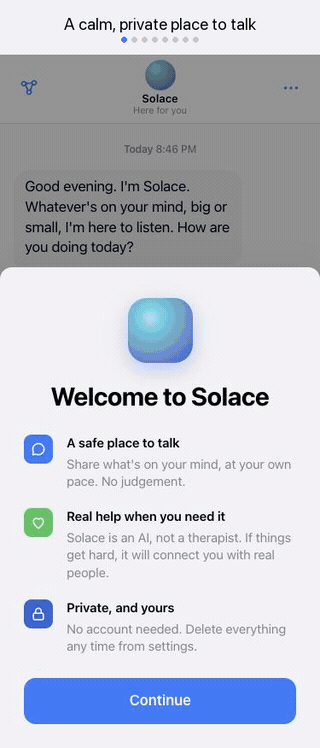
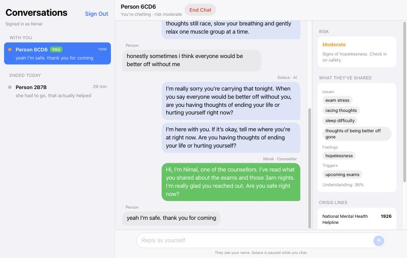

# Solace

**An open-source AI companion that listens, helps people understand what they are going through, and connects them to real help.**

> ⚠️ Solace is an AI. It is **not** a therapist, doctor, or emergency service.
> If you are in danger right now, call your local emergency number.
> In Sri Lanka: **1926** (National Mental Health Helpline, 24/7) · **1333** (CCCline) · **119** (Emergency).
> Elsewhere: [findahelpline.com](https://findahelpline.com).

<p align="center">
  
</p>

## What it does

- **Talks like a caring person, not a chatbot.** Replies stream in as they are written, match the person's tone and length, and remember the details they shared.
- **Talk out loud in real time.** Tap the waveform button for a voice call, like a phone call with a friend. Speech goes straight between the browser and OpenAI over WebRTC, with live captions, mute, and a transcript saved to the chat.
- **Feels like a native app.** A calm, Apple-style interface with light and dark mode, tap-to-call crisis lines, and a conversation that survives a page reload.
- **Checks every message for suicide and self-harm risk.** There are two independent checks: a fast keyword screen and an AI screener. Either one can raise the alarm.
- **Switches to crisis mode** when risk is high. It stays calm, asks about safety directly, and connects the person to crisis lines and real people. If the AI fails, a fixed safety message is sent instead, so a person in crisis never sees an error.
- **Builds a private map (issue graph)** of what the person is going through: issues, feelings, triggers, people and supports, and how they connect. It uses roles, never names.
- **Asks gentle questions to fill gaps** (when it started, sleep, support, daily life and more). These are loosely guided by PHQ-9 / GAD-7, one at a time, never like a form, and never during a crisis.
- **Draws on trusted knowledge, with sources.** A small library of notes on sleep, stress, anxiety, panic, low mood, grief, loneliness, anger, exam stress, self-harm urges and getting help (from WHO and NHS guidance), plus opt-in comfort from Buddhist, Hindu, Islamic and Christian teaching. Solace uses at most one idea at a time, in its own words, only when it helps, and shows tappable sources under the reply.
- **Connects to a real person.** Anyone can ask for a counsellor from the crisis card or Settings. Only with their consent, a trained counsellor sees the conversation and map in a dashboard, joins the same chat live, and Solace steps back. Risk is still screened on every message, urgent chats rise to the top, and every look at a conversation is audit-logged.
- **Lets the person delete everything** with one button.
- **Includes faith only if the person chooses it** (Buddhism, Hinduism, Islam, Christianity, or none).
- Never diagnoses, and never gives medication advice.

Read the [Safety Policy](SAFETY.md) before contributing.

## Quick start

```bash
git clone https://github.com/kashmithnisakya/solace.git
cd solace
cp .env.example .env        # add your OPENAI_API_KEY
uv sync
uv run uvicorn solace.api:app --reload
```

Open http://localhost:8000.

### Production notes

- Run behind HTTPS and a reverse proxy, with `uvicorn --proxy-headers` so rate limiting sees real client IPs.
- The built-in rate limit (20 messages/minute per client) is in memory. Use a shared store such as Redis when running several instances.
- Strict security headers are on by default (CSP, no framing, no referrer, `no-store` on API responses).
- Message content is never logged; only risk levels are.

With Docker: `docker compose up --build`.

## API

| Method | Path | Description |
|---|---|---|
| `POST` | `/api/chat/stream` | Same request; replies as server-sent events: `start` → `delta`… → `done` |
| `GET` | `/api/sessions/{id}/messages` | Restore a conversation's messages |
| `POST` | `/api/chat` | `{"message": "...", "session_id": null, "faith": "buddhism"}` → reply, risk level, resources |
| `GET` | `/api/sessions/{id}/graph` | The person's issue graph, coverage, and next area to explore |
| `DELETE` | `/api/sessions/{id}` | Delete the conversation, graph and risk state |
| `GET` | `/api/resources` | Crisis lines for the configured region |
| `POST` | `/api/sessions/{id}/handoff` | Ask for a counsellor (`{"consent": true}` required); `GET` for status, `DELETE` to cancel or end |
| `GET` | `/api/sessions/{id}/live` | Server-sent events: counsellor joined, messages, chat ended |
| `GET` | `/counsellor` | Counsellor dashboard (sign-in required); its API lives under `/api/counsellor/` |
| `POST` | `/api/voice/session` | Start a voice call: returns a short-lived key for the browser's WebRTC connection |
| `POST` | `/api/voice/turn` | Save a finished transcript; user speech is risk-screened and returns the instructions to use next |
| `GET` | `/health` | Health check |

## How it works

```
message ─► keyword screen ─┐
         └► AI risk screener ┴─► highest risk wins
                                   │
                 high / imminent ──┼──► Crisis Support agent  (+ crisis lines, always)
                 none … moderate ──┴──► Companion agent       (+ crisis lines from moderate up)
                                              ▲ knows the graph + one gap to gently ask about
message ─► Graph Builder agent (in parallel) ─► issue graph (SQLite)
```

For each message, the knowledge base is searched while the risk check runs (so it adds no waiting). Close
matches are given to the Companion as notes; the Crisis agent never gets them, so crisis replies stay focused on safety.
Replies mark ideas they took from a note like `[1]`; the app hides the markers and shows those sources as links.

Voice calls use the same rules. The browser streams audio directly to the OpenAI Realtime API (our server never
relays audio and never shares the real API key). Each finished transcript of what the person said goes through the
same risk checks. If risk becomes high, the browser stops the current spoken reply and Solace answers again in
crisis mode, while the call screen shows tap-to-call buttons.

Built with Python, [FastAPI](https://fastapi.tiangolo.com) and the [OpenAI Agents SDK](https://openai.github.io/openai-agents-python/).

```
solace/
├── api.py              FastAPI app
├── conversation.py     safety-first routing between agents (text and voice)
├── voice.py            Realtime voice: short-lived keys and spoken instructions
├── platform/           counsellor accounts, consented hand-off, live updates, dashboard API
├── knowledge/          knowledge base search and citations; library/ holds the notes (Markdown)
├── assessment.py       picks the next area worth gently asking about
├── graph/              issue graph models and storage
├── config.py           settings from .env
├── assistants/         companion, crisis, risk-screener and graph-builder agents
├── safety/             keyword screen, risk levels, crisis lines
└── web/                Apple-style web app (index.html, static/app.css, static/app.js)
tests/                  unit tests, including crisis-phrase test cases
evals/                  safety evaluation: datasets, runner, AI judge
```

## Counsellors

<p align="center">
  
</p>

People never need an account. Counsellors do, created from the command line:

```bash
uv run python -m solace.platform add-counsellor --email nimal@example.org --name "Nimal"
uv run python -m solace.platform list
uv run python -m solace.platform disable --email nimal@example.org
```

They sign in at `/counsellor`. A counsellor counts as online while the dashboard is open. Login cookies are
HTTPS-only; for local development over plain HTTP in Safari, set `SOLACE_SECURE_COOKIES=false`.
Live updates run in-process, so run a single worker (or swap the broker for Redis pub/sub before scaling out).

## Safety evaluation

A red-team suite checks the whole pipeline with real models: 57 messages for risk detection (explicit,
indirect, coded, multi-turn, third-party, negations, figures of speech that must not raise an alarm, and Sinhala)
and 23 conversations whose replies an AI judge scores against safety rules (crisis care, method-seeking and
jailbreaks, medication, diagnosis, faith, honesty, tone), backed by hard checks that need no AI.

```bash
uv run python -m evals            # everything, about a minute; needs OPENAI_API_KEY
uv run python -m evals risk       # or just one suite
```

It fails on any critical miss: a high-risk message not caught, or a reply that leaks method or dose
information, gives medication advice, promises secrecy, or skips the safety question and crisis line in a crisis.
The keyword-screen part runs offline in CI on every change; the live run is a manual GitHub workflow.
Latest results: [docs/safety](docs/safety/2026-11-26-baseline.md).

## Adding knowledge

Add a Markdown file to `solace/knowledge/library/`, written in your own words (never paste copyrighted text), with front matter:

```markdown
---
title: Coping with exam stress
source: NHS, "Tips on preparing for exams"
url: https://www.nhs.uk/...
topic: study
faith: islam          # only for faith notes; used only when the person chooses that faith
---
## A short section heading
One focused idea per section, a few sentences long.
```

New sections are embedded automatically on the next start (embeddings are cached in the database).
Knowledge content needs the same professional review as prompts.

## Roadmap

See [docs/ROADMAP.md](docs/ROADMAP.md). Next up: Sinhala support.

## Development

```bash
uv run pytest
uv run ruff check . && uv run ruff format .
```

Contributions are very welcome, especially from mental-health professionals. See [CONTRIBUTING.md](CONTRIBUTING.md). Coding agents should follow [AGENTS.md](AGENTS.md).

## License

[MIT](LICENSE)
